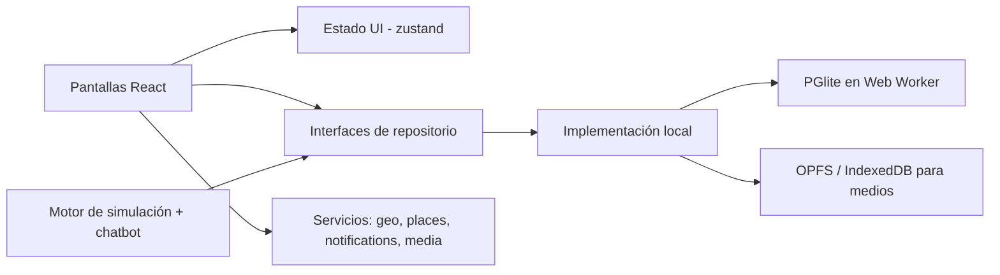
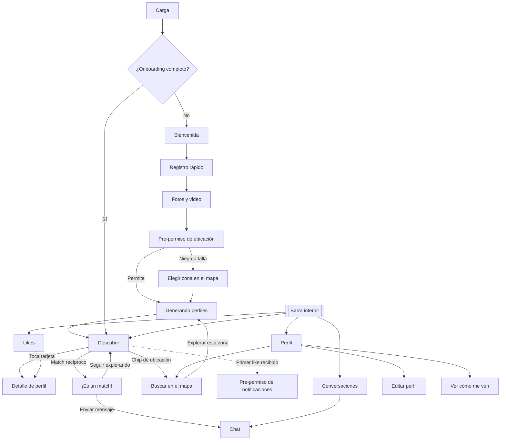

# CLAUDE.md — POC "Chispa": simulador de citas tipo Tinder

> Nombre de trabajo: **Chispa** (puede cambiar). Este archivo es la fuente de verdad del proyecto. Léelo completo antes de escribir código.

---

## 0. Cómo debes trabajar

1. **Empieza en modo plan.** Presenta el plan de la Fase 1 (sección 13) y espera aprobación antes de escribir código.
2. **Trabaja por fases.** Al cerrar cada fase:
   - `npm run build` pasa sin errores ni warnings de TypeScript.
   - Se cumplen sus criterios de aceptación.
   - Haces un commit: `feat(fase-N): <resumen>`.
3. **Las decisiones de la sección 3 no se cambian sin preguntar.** Si algo choca con ellas, detente y pregunta.
4. **Si algo no está definido**, elige la opción más simple, sigue adelante y anótala en `docs/decisiones.md` con el motivo.
5. **Idioma:** toda la interfaz en español de México. Código, nombres de archivos y variables en inglés.
6. **Dependencias:** solo las listadas aquí. Cualquier otra, justifícala en `docs/decisiones.md`.

---

## 1. Objetivo

Construir un **POC web móvil** que simule la experiencia esencial de una app de citas tipo Tinder:

- Crear un perfil con fotos y video.
- Descubrir perfiles cercanos (dummies generados).
- Reaccionar con **Skip, Pasar, Match y Like**.
- Hacer match y chatear con un chatbot por plantillas.
- Recibir likes con notificaciones.
- Buscar en el mapa dónde estás o a dónde irás.

Todo corre **en el navegador, sin backend**, y se publica en **GitHub Pages**.

**Para qué sirve:** validar el flujo y la experiencia rápido con stakeholders, y dejar una base que migre a multiusuario (Supabase) sin rehacer pantallas.

## 2. Público

- Adultos jóvenes de 18 a 34 años, principalmente Gen Z, en México. Primera ciudad de referencia: Monterrey.
- Uso casi exclusivo en celular.
- Contexto de mercado: hay "swipe fatigue". La experiencia debe sentirse ligera, intencional y orientada a conversar y quedar en persona.

---

## 3. Decisiones tomadas (no cambiar sin preguntar)

| Tema | Decisión | Motivo |
|---|---|---|
| Hosting | GitHub Pages, sitio 100% estático | Gratis y con HTTPS, que el navegador exige para la ubicación |
| Stack | Vite + React + TypeScript | Mantenible y con camino a producto |
| Rutas | Hash router (`#/descubrir`) | GitHub Pages no soporta rutas de SPA |
| Base de datos | PGlite (Postgres en WASM) dentro de un Web Worker, guardando en IndexedDB | Postgres real en el navegador, mismo SQL que Supabase |
| Capa de datos | Interfaces de repositorio; la UI nunca llama a PGlite directo | Cambiar a Supabase sin tocar pantallas |
| Medios del usuario | Archivos en OPFS (respaldo: IndexedDB); metadatos en PGlite | No inflar la base con binarios |
| Ubicación | Geolocation API del navegador; si se niega o falla, elegir en el mapa | Gratis, sin llaves |
| Mapa | Leaflet + teselas de OpenStreetMap, con atribución | Gratis, sin llaves |
| Búsqueda de lugares | Photon (`photon.komoot.io`) con autocompletado | Permite autocompletar; **no usar Nominatim para autocompletar**, sus reglas lo prohíben |
| Dummies | **Solo** avatares ilustrados (SVG) y videos hechos por IA | Nada de fotos de personas reales |
| Acciones | Skip, Pasar, Match y Like, con el significado de la sección 6 | Acordado con producto |
| Chat | Chatbot por plantillas con respuestas rápidas; sin IA ni llaves de API | Un sitio estático no puede guardar llaves de forma segura |
| Navegación | Barra inferior con 4 pestañas: **Descubrir · Likes · Conversaciones · Perfil** | Patrón del mercado (Tinder, Hinge) y guía de Android para 3–5 secciones |
| Design system | Dirección **"Chispa"** (sección 7), solo tema claro | Elegida por producto |
| Animaciones de carga | 3 animaciones Lottie hechas a medida, reproducidas con dotLottie; respaldo en CSS | Coherentes con la marca y sin licencias |
| Notificaciones | Avisos dentro de la app + notificaciones del sistema mientras la app esté abierta (aunque esté en segundo plano) | Sin servidor no hay push con la app cerrada |
| Privacidad en el mapa | Solo se muestran zonas aproximadas, nunca el punto exacto de nadie | Igual que Tinder |
| PWA | Instalable; cachea assets, fuentes y el WASM | Uso tipo app y modo sin conexión |
| Deploy | GitHub Actions publica en GitHub Pages en cada push a `main` | Automático |

## 4. Fuera de alcance

- Backend, usuarios reales o multiusuario.
- Login con contraseña.
- Pagos o suscripciones.
- IA para matching o chat.
- Verificación facial y moderación de contenido.
- Notificaciones push con la app cerrada.
- Deshacer el último swipe.

---

## 5. Arquitectura

### 5.1 Dependencias

- `react`, `react-dom`, `react-router-dom` (con `createHashRouter`)
- `@electric-sql/pglite` (usar `PGliteWorker`)
- `leaflet`, `react-leaflet`
- `@lottiefiles/dotlottie-react`
- `@phosphor-icons/react`
- `@fontsource/plus-jakarta-sans` (fuente local, funciona sin conexión)
- `zustand` (estado de UI ligero)
- `vite-plugin-pwa`
- Desarrollo: `vitest`, `@testing-library/react`

### 5.2 Configuración clave

- `vite.config.ts`:
  - `base: '/<nombre-del-repo>/'`. Usa `import.meta.env.BASE_URL` para toda ruta de assets.
  - `optimizeDeps: { exclude: ['@electric-sql/pglite'] }`, como recomienda la documentación de PGlite.
- Carga diferida (lazy) de Leaflet y de la pantalla de mapa para no inflar la carga inicial.

### 5.3 Capas



### 5.4 Estructura de carpetas

```
src/
  app/            router, providers, AppShell (TabBar o rail lateral)
  screens/        una carpeta por pantalla (sección 8.2)
  components/     ProfileCard, ActionBar, MediaCarousel, Button, Chip,
                  Input, SegmentedToggle, BottomSheet, Toast, TabBar, EmptyState
  design/         tokens.css, global.css
  data/
    db/           worker.ts, migrations/*.sql
    repo/         interfaces (UserRepo, DiscoveryRepo, SwipeRepo, LikeRepo,
                  MatchRepo, ChatRepo, MediaRepo, NotificationRepo) + local/
  sim/            seed.ts, prng.ts, avatars.ts, scoring.ts, dummyBehavior.ts
    chatbot/      engine.ts, intents.ts, scripts.es.json
  services/       geo.ts, places.ts (Photon), notifications.ts, media.ts
public/
  dummies/videos/ *.mp4, *.webp y videos.json
  lottie/         heart.lottie, radar.lottie, cards.lottie
docs/
  decisiones.md
```

### 5.5 Pantallas grandes

- Hasta 767 px: barra inferior.
- Desde 768 px: la barra pasa a **riel lateral izquierdo** y la tarjeta se centra con ancho máximo de 430 px.

---

## 6. Acciones sobre un perfil

| Acción | Gesto | Botón | Qué hace |
|---|---|---|---|
| **Skip** | Arrastrar a la izquierda | ✕ gris | Descarta el perfil. No vuelve a aparecer. |
| **Pasar** | Arrastrar hacia abajo | Doble flecha ámbar | Lo deja para después; vuelve al **final** de la baraja. |
| **Match** | Arrastrar a la derecha | Corazón verde | Muestra interés. Si el dummy también te quiere, se crea un match. |
| **Like** | Doble toque sobre una foto o video | Corazón rosa sobre el medio | Reacción a ese medio en específico. **No** intenta match. |

- Umbral de arrastre: 30% del ancho (o alto, para Pasar) o velocidad mayor a 0.5 px/ms.
- Mientras se arrastra, la tarjeta rota hasta ±12° y aparece la etiqueta "SKIP", "PASAR" o "MATCH".
- Glosario: **Match** con mayúscula es la acción; **match** con minúscula es el resultado cuando ambos se eligen.

---

## 7. Design system "Chispa"

Estos tokens son la fuente de verdad. Ponlos en `src/design/tokens.css`.

```css
:root {
  /* Color */
  --color-bg: #FFF8F5;
  --color-surface: #FFFFFF;
  --color-surface-2: #FFF0EA;
  --color-border: #F1E3DC;
  --color-border-strong: #E6D2C9;
  --color-text: #2A1A1F;
  --color-text-muted: #7A6268;
  --gradient-primary: linear-gradient(135deg, #D93A52, #B5175A);
  --color-primary: #C21A5F;          /* íconos, enlaces, pestaña activa */
  --color-accent: #FFD166;           /* chip seleccionado, detalles */
  --color-on-primary: #FFFFFF;

  /* Acciones */
  --color-skip: #8A7A80;
  --color-pasar: #D97706;
  --color-match: #16A34A;
  --color-like: #E11D74;
  --color-like-soft: #FDE4EF;

  /* Forma */
  --radius-sm: 14px;
  --radius-lg: 24px;
  --radius-pill: 999px;

  /* Espaciado (base 4) */
  --space-1: 4px;  --space-2: 8px;  --space-3: 12px;
  --space-4: 16px; --space-6: 24px; --space-8: 32px;

  /* Sombra */
  --shadow-card: 0 8px 24px rgba(42, 26, 31, 0.10);
  --shadow-button: 0 6px 16px rgba(42, 26, 31, 0.10);

  /* Tipografía */
  --font-sans: 'Plus Jakarta Sans', system-ui, sans-serif;
}
```

**Tipografía (Plus Jakarta Sans):**

| Estilo | Peso | Tamaño / interlineado | Uso |
|---|---|---|---|
| Display | 800 | 40 / 44, tracking -0.03em | "¡Es un match!", títulos grandes |
| Título | 700 | 24 / 30 | Encabezados de pantalla |
| Nombre en tarjeta | 800 | 22 / 28 | "Valeria, 27" |
| Cuerpo | 400 | 16 / 24 | Bios, mensajes |
| Etiqueta | 700 | 13 / 18 | Distancia, chips |
| Micro | 700 | 11 / 14 | Etiquetas de la barra inferior |

**Componentes:**

- **Botón primario:** fondo `--gradient-primary`, texto blanco 16 px peso 800, alto 48 px, píldora.
- **Botón secundario:** fondo blanco, borde 1.5 px `--color-border-strong`, texto `--color-text`.
- **Chip:** píldora, 14 px. Seleccionado: fondo `--color-accent` y texto `--color-text`. Normal: fondo blanco con borde `--color-border`.
- **Input:** alto 48 px, radio `--radius-sm`, borde 1.5 px `--color-border-strong`; foco con borde `--color-primary`.
- **Toggle segmentado:** contenedor `--color-surface-2`; opción activa con el degradado y texto blanco.
- **Tarjeta de perfil:** radio `--radius-lg`, `--shadow-card`, medio arriba e info abajo sobre fondo blanco.
- **ActionBar:** círculos blancos con `--shadow-button` e ícono en el color de la acción. Tamaños: Skip 52, Pasar 44, Match 60.
- **Like sobre medio:** círculo blanco de 44 px con corazón relleno `--color-like`, abajo a la derecha del medio.
- **TabBar:** 4 pestañas con ícono y etiqueta Micro. Activa en `--color-primary`, inactiva en `--color-text-muted`. Badge numérico rosa en Likes y Conversaciones.
- **Íconos:** Phosphor, peso "regular"; el ícono activo de la TabBar en "fill".

**Accesibilidad:** contraste AA, áreas táctiles de al menos 44 px, `aria-label` en todo botón con solo ícono, y respeto a `prefers-reduced-motion` (sin rotaciones ni loops; las Lottie se quedan en un fotograma fijo).

---

## 8. Flujo de usuario

### 8.1 Mapa general



La barra inferior solo se muestra en Descubrir, Likes, Conversaciones y Perfil. Se oculta en onboarding, Chat, Detalle y Mapa.

### 8.2 Fichas por pantalla

Formato de cada ficha: **ruta · objetivo · llega desde · muestra · acciones → destino · estados · datos**.

#### 1. Carga — `#/`
- **Objetivo:** iniciar la base y decidir a dónde mandar al usuario.
- **Muestra:** Lottie del corazón que se arma con dos mitades. El primer fotograma es CSS puro, para que aparezca al instante.
- **Hace:** inicia PGlite, corre migraciones, siembra datos si faltan y lee `app_meta.onboarding_step`.
- **Destino:** el paso de onboarding pendiente o Descubrir. Visible al menos 600 ms para evitar parpadeo.
- **Estados:** si la base falla, mensaje con "Reintentar" y "Borrar datos locales".

#### 2. Bienvenida — `#/bienvenida`
- **Muestra:** propuesta de valor en una línea y el aviso "Es una demo: tus datos solo viven en este dispositivo".
- **Acciones:** "Crear mi perfil" → Registro.

#### 3. Registro rápido — `#/registro`
- **Muestra (una sola pantalla):** nombre, fecha de nacimiento, género (mujer, hombre, no binario), a quién buscas (selección múltiple), rango de edad (doble slider de 18 a 60) y distancia máxima (por defecto 25 km).
- **Validación:** menores de 18 quedan **bloqueados** con un mensaje claro. "Continuar" se habilita solo con todo válido.
- **Acciones:** "Continuar" → Fotos y video.
- **Datos:** guarda borrador en cada cambio (`app_user` + `onboarding_step = 'registro'`).

#### 4. Fotos y video — `#/medios`
- **Muestra:** cuadrícula de 6 espacios para fotos y 1 para video; la primera foto es la principal.
- **Reglas:**
  - Mínimo 1 foto, máximo 6. Se reordenan arrastrando.
  - Fotos: se convierten a WebP, lado mayor de 1080 px, calidad 0.8.
  - Video: máximo 15 s y 30 MB; si excede, se rechaza con mensaje (no se recorta). Se genera una imagen de portada del primer segundo.
- **Estados:** procesando por archivo, formato no soportado y almacenamiento lleno.
- **Acciones:** "Continuar" → Pre-permiso de ubicación.
- **Datos:** archivos en OPFS y filas en `media`.

#### 5. Pre-permiso de ubicación — `#/ubicacion`
- **Muestra:** Lottie del pin con ondas de radar y el texto "Usamos tu ubicación para mostrarte gente cerca. Nadie ve tu punto exacto."
- **Acciones:**
  - "Permitir ubicación" → `getCurrentPosition` (timeout 10 s, `enableHighAccuracy: false`) → Generando.
  - "Prefiero elegir en el mapa" → Elegir zona.
- **Estados:** si se niega, hay timeout o falla → Elegir zona, con un aviso breve.

#### 6. Buscar en el mapa / Elegir zona — `#/mapa`
- **Modos de uso:** desde onboarding solo aparece "Estoy aquí". Desde Descubrir o Perfil aparecen los dos modos.
- **Muestra:**
  - Mapa Leaflet a pantalla completa.
  - Buscador flotante arriba con resultados (hasta 5).
  - Pin y círculo de radio.
  - Hoja inferior con el toggle **Estoy aquí / Voy a ir**, fechas (solo en Voy a ir), radio (5, 10, 25 o 50 km), "Explorar esta zona" y "Usar mi ubicación actual".
- **Buscador (Photon):**
  - Debounce de 350 ms, mínimo 3 caracteres, sesgado a la ubicación actual, `limit=5`.
  - Sin parámetro de idioma (usa nombres locales).
  - Guarda en caché las búsquedas repetidas.
- **Otros perfiles:** se ven como manchas de zona (círculos de unos 400 m con desplazamiento aleatorio), nunca como puntos exactos.
- **Acciones:**
  - Tocar el mapa mueve el pin.
  - "Explorar esta zona" guarda `location_context` → Generando.
- **Estados:** si Photon falla, aviso y se permite elegir tocando el mapa. Sin conexión: aviso.
- **Atribución obligatoria:** "© OpenStreetMap contributors" y "Búsqueda: Photon".

#### 7. Generando perfiles — `#/generando`
- **Muestra:** Lottie de tarjetas apiladas que se deslizan y el texto "Buscando gente cerca de {zona}".
- **Hace:** genera los dummies de la zona si no existen (sección 9).
- **Destino:** Descubrir. Visible al menos 600 ms.

#### 8. Descubrir — `#/descubrir`
- **Muestra:**
  - Barra superior: chip de ubicación (zona y flecha, abre el mapa) y botón de filtros.
  - Tarjeta que ocupa todo el espacio entre la barra superior y la inferior.
  - Medios en carrusel: segmentos arriba; tocar el lado izquierdo o derecho cambia de medio.
  - Video en autoplay, silenciado y en loop; un toque activa el sonido.
  - Info: nombre y edad, "3 km · Barrio Antiguo" (distancia redondeada) e intereses en chips. Los intereses en común resaltados.
  - ActionBar con Skip, Pasar y Match. Like sobre el medio.
- **Acciones:**
  - Las cuatro de la sección 6.
  - Tocar la info → Detalle.
  - Match recíproco → modal ¡Es un match!.
- **Filtros (hoja inferior):** edad, distancia e intereses.
- **Estado vacío:** "Ya viste a todos por aquí" con "Ampliar distancia", "Cambiar zona" y "Ver los que pasaste".
- **Datos:** `swipe`, `media_like`, `match`.

#### 9. Detalle de perfil — `#/persona/:id`
- **Muestra:** todos los medios, bio completa, intereses y zona.
- **Acciones:** las mismas de Descubrir. Si llegó desde Likes, Match crea el match al instante.

#### 10. ¡Es un match! (modal sobre Descubrir)
- **Muestra:** los dos avatares, título Display y 3 respuestas rápidas sugeridas para abrir la conversación.
- **Acciones:** tocar una sugerencia o "Enviar mensaje" → Chat; "Seguir explorando" cierra el modal.

#### 11. Likes — `#/likes`
- **Muestra:** cuadrícula de quienes te dieron like, con etiqueta "Le gustó tu perfil", "Le gustó tu foto" o "Le gustó tu video" y hace cuánto. Los no vistos van primero.
- **Acciones:** tocar → Detalle.
- **Estados:** vacío ("Aún no hay likes. Sigue explorando").
- **Datos:** al entrar se marcan como vistos y se limpia el badge.

#### 12. Conversaciones — `#/conversaciones`
- **Muestra:**
  - Arriba, carrusel "Nuevos matches" con los que aún no tienen mensajes.
  - Abajo, lista de chats ordenada por último mensaje: avatar, nombre, vista previa, hora y punto de no leído.
- **Acciones:** tocar → Chat.
- **Estados:** vacío ("Cuando hagas match, tus conversaciones aparecen aquí").
- **Datos:** al primer arranque se siembran **2 o 3 conversaciones ya empezadas**, una de ellas con mensaje sin leer.

#### 13. Chat — `#/chat/:matchId`
- **Muestra:**
  - Encabezado: volver, avatar, nombre y "Ver perfil".
  - Burbujas de mensajes, con indicador "escribiendo…".
  - Respuestas rápidas como chips encima del campo de texto.
  - Campo de texto libre.
- **Acciones:** enviar un chip o texto libre; el dummy responde según la sección 10.
- **Datos:** `message`, `chat_state`. Al entrar se marcan los mensajes como leídos.

#### 14. Perfil — `#/perfil`
- **Muestra los datos del usuario:** fotos y video, nombre, edad, bio, intereses, preferencias (edad, distancia, a quién busca), ubicación actual con su modo y estado de las notificaciones.
- **Acciones:**
  - "Editar perfil" → Editar.
  - "Ver cómo me ven" → Vista previa.
  - "Cambiar ubicación" → Mapa.
  - "Notificaciones" → pide permiso o explica cómo activarlas.
  - "Borrar mis datos" → confirmación → borra la base y OPFS → Bienvenida.

#### 15. Editar perfil — `#/perfil/editar`
- **Muestra:** los mismos campos del registro más medios, bio (máximo 300 caracteres) e intereses (3 a 8 del catálogo).
- **Acciones:** "Guardar" → Perfil, con un aviso de confirmación.

#### 16. Ver cómo me ven — `#/perfil/vista`
- **Muestra:** tu propia tarjeta en formato Descubrir, sin acciones.

#### 17. Pre-permiso de notificaciones (hoja inferior)
- **Cuándo aparece:** después del **primer like recibido**, nunca al abrir la app.
- **Muestra:** "Te avisamos cuando alguien te dé like o te escriba".
- **Acciones:**
  - "Activar" → `Notification.requestPermission()`.
  - "Ahora no" → no se vuelve a pedir en 3 días (`app_meta`).

### 8.3 Recorridos clave

**R1. Primer uso**
1. Abre la URL → Carga → Bienvenida → "Crear mi perfil".
2. Llena el registro (18+) → sube 2 fotos y 1 video de 10 s.
3. Pre-permiso → permite ubicación → Generando → Descubrir con 40 perfiles cerca.

**R2. Match y chat**
1. En Descubrir arrastra a la derecha a Valeria → el dummy acepta → modal ¡Es un match!.
2. Toca la sugerencia "¡Hola! Vi que también te gusta el senderismo".
3. Chat: aparece "escribiendo…" y Valeria responde según su personalidad.
4. Llegan a proponer un plan. Al recargar, todo sigue ahí y aparece en Conversaciones.

**R3. Recibir un like**
1. Con la app abierta, un dummy compatible da like a tu video.
2. Aparece un aviso dentro de la app y sube el badge de Likes.
3. Si es el primer like, aparece el pre-permiso. Si ya hay permiso, llega una notificación del sistema (también con la app en segundo plano).
4. Tocar el aviso o la notificación → Likes → Detalle → Match crea el match al instante.

**R4. Explorar otra zona con "Voy a ir"**
1. Toca el chip de ubicación → Mapa → elige "Voy a ir".
2. Busca "Cintermex" → elige el resultado → fechas del 18 al 20 de octubre → radio de 10 km.
3. "Explorar esta zona" → Generando → Descubrir muestra gente de esa zona. El chip dice "Cintermex · 18–20 oct".

**R5. Editar perfil**
1. Perfil → Editar → cambia la bio y reordena fotos → Guardar.
2. "Ver cómo me ven" muestra los cambios.

### 8.4 Casos borde

| Caso | Comportamiento |
|---|---|
| Menor de 18 | Bloqueado en registro con mensaje; no se guarda nada |
| Niega la ubicación | Va a Elegir zona en el mapa; puede reintentar después desde Perfil |
| GPS lento o sin señal | Timeout de 10 s → Elegir zona |
| Video de más de 15 s o 30 MB | Se rechaza con mensaje claro |
| Formato no soportado (HEIC, etc.) | Mensaje: "Usa JPG, PNG o WebP" |
| Almacenamiento lleno | Aviso y sugerencia de borrar medios |
| Recarga a mitad del registro | Retoma en el paso guardado con los datos ya escritos |
| Se acaban los perfiles | Estado vacío de Descubrir (pantalla 8) |
| Todos pasados con "Pasar" | Vuelven a aparecer en orden |
| Sin conexión | La app funciona; el mapa y la búsqueda muestran aviso |
| Navegador sin OPFS | Usar IndexedDB para medios |
| Notificaciones bloqueadas | Solo avisos dentro de la app; en Perfil se explica cómo activarlas |
| iPhone sin instalar la app | No hay notificaciones del sistema; en Perfil se sugiere instalarla en la pantalla de inicio |
| Dos pestañas abiertas | PGlite es de una sola conexión: la segunda pestaña muestra "La app ya está abierta en otra pestaña" |

---

## 9. Modelo de datos

Archivo `src/data/db/migrations/001_init.sql`:

```sql
create table app_user (
  id uuid primary key default gen_random_uuid(),
  is_dummy boolean not null default false,
  name text not null,
  birthdate date not null,
  gender text not null check (gender in ('mujer','hombre','no_binario')),
  seeking text[] not null,
  age_min int not null default 18,
  age_max int not null default 45,
  max_distance_km int not null default 25,
  bio text,
  interests text[] not null default '{}',
  lat double precision,
  lng double precision,
  area_label text,
  personality text check (personality in ('bromista','directa','timida')), -- solo dummies
  pickiness real,                                                            -- solo dummies, 0..1
  avatar_seed int,                                                           -- solo dummies
  zone_key text,                                                             -- zona en la que se generó
  created_at timestamptz not null default now()
);

create table location_context (
  user_id uuid primary key references app_user(id) on delete cascade,
  mode text not null check (mode in ('aqui','voy')),
  lat double precision not null,
  lng double precision not null,
  label text not null,
  radius_km int not null default 10,
  date_from date,
  date_to date,
  updated_at timestamptz not null default now()
);

create table media (
  id uuid primary key default gen_random_uuid(),
  user_id uuid not null references app_user(id) on delete cascade,
  kind text not null check (kind in ('photo','video','avatar')),
  position int not null,
  storage text not null check (storage in ('opfs','idb','static','generated')),
  path text not null,
  poster_path text,
  duration_s real,
  created_at timestamptz not null default now()
);

create table swipe (
  id uuid primary key default gen_random_uuid(),
  from_user uuid not null references app_user(id) on delete cascade,
  to_user uuid not null references app_user(id) on delete cascade,
  action text not null check (action in ('skip','pasar','match')),
  created_at timestamptz not null default now()
);

create table media_like (
  id uuid primary key default gen_random_uuid(),
  from_user uuid not null references app_user(id) on delete cascade,
  to_user uuid not null references app_user(id) on delete cascade,
  media_id uuid references media(id) on delete cascade, -- null = like al perfil
  seen boolean not null default false,
  created_at timestamptz not null default now()
);

create table match (
  id uuid primary key default gen_random_uuid(),
  user_a uuid not null references app_user(id) on delete cascade,
  user_b uuid not null references app_user(id) on delete cascade,
  created_at timestamptz not null default now(),
  unique (user_a, user_b)
);

create table message (
  id uuid primary key default gen_random_uuid(),
  match_id uuid not null references match(id) on delete cascade,
  sender uuid not null references app_user(id) on delete cascade,
  body text not null,
  created_at timestamptz not null default now(),
  read_at timestamptz
);

create table chat_state (
  match_id uuid primary key references match(id) on delete cascade,
  node text not null,
  updated_at timestamptz not null default now()
);

create table notification (
  id uuid primary key default gen_random_uuid(),
  user_id uuid not null references app_user(id) on delete cascade,
  type text not null check (type in ('like_perfil','like_media','match','mensaje')),
  payload jsonb not null default '{}',
  created_at timestamptz not null default now(),
  read_at timestamptz
);

create table app_meta (
  key text primary key,
  value jsonb not null
);
-- Claves: schema_version, seed_version, onboarding_step, local_user_id,
--         notif_prompt_snoozed_until, incoming_likes_session_count
```

**Distancia:** mide en la Fase 1 cuánto pesa cargar la extensión PostGIS de PGlite. Si es aceptable, úsala. Si no, crea una función `haversine_km(lat1, lng1, lat2, lng2)` en SQL. Anota la decisión en `docs/decisiones.md`.

**"Pasar":** no es definitivo. La consulta de la baraja ordena primero lo nunca visto y al final lo pasado, por fecha del último "pasar".

---

## 10. Reglas del simulador

### 10.1 Generación de dummies
- **Semilla determinista:** `seed = hash(zone_key + seed_version)`, con `zone_key` = lat/lng redondeadas a 2 decimales. PRNG `mulberry32`. La misma zona siempre genera los mismos dummies.
- **40 dummies por zona**, ubicados al azar dentro del radio. Su `area_label` sale del nombre de colonia más cercano que devuelva Photon para el centro de la zona, o "Cerca de ti" si no hay.
- **Atributos:**
  - Nombre de una lista de nombres comunes en México.
  - Edad de 18 a 45, género y a quién busca.
  - De 3 a 6 intereses de un catálogo de 30.
  - Bio armada con plantillas.
  - Personalidad (bromista, directa o tímida) y exigencia entre 0.2 y 0.8.
- **Avatar ilustrado:** SVG generado por piezas a partir de `avatar_seed` (fondo, figuras decorativas, tono de piel, peinado, color de ropa). Mismo estilo plano que el mockup de Chispa. Sin rasgos de personas reales.
- **Videos IA:** alrededor del 30% de los dummies tiene uno, asignado desde `public/dummies/videos/videos.json`. Si el manifiesto está vacío, solo avatares.

### 10.2 Compatibilidad (0 a 1)
- **Filtros duros:** género y edad mutuamente compatibles, y dentro de la distancia máxima del usuario.
- **Puntaje:**
  - 0.35 × intereses en común (índice de Jaccard).
  - 0.25 × cercanía (`1 - distancia / radio`).
  - 0.20 × qué tan centrada está la edad en las preferencias de ambos.
  - 0.20 × ruido determinista por pareja.
- **Orden de la baraja:** por puntaje, mezclando al azar dentro de bloques de 5 para que no se sienta rígido.

### 10.3 Comportamiento de los dummies
- **Responder a tu Match:** probabilidad `clamp(puntaje × (1.2 − exigencia), 0.05, 0.9)`.
- **Likes previos:** alrededor del 15% de los dummies con puntaje mayor a 0.5 ya "te dio like" al generarse. Tu Match con ellos es match inmediato.
- **Likes entrantes (solo con la app abierta):**
  - Cada 45 a 120 s se elige un dummy compatible que aún no te haya dado like.
  - 60% like a tu perfil, 40% like a una foto o video tuyo.
  - Máximo 10 por sesión.
  - Cada like crea una fila en `notification` y dispara el aviso.
- **Primer mensaje del dummy:** tras un match, 30% de probabilidad de que el dummy escriba primero, entre 20 y 90 s después.

### 10.4 Notificaciones
- **Dentro de la app:** aviso emergente (Toast) de 4 s con avatar y texto ("A Valeria le gustó tu video"), y badges en Likes y Conversaciones.
- **Del sistema:** si hay permiso y la pestaña no está visible, usar `ServiceWorkerRegistration.showNotification()` (en Android `new Notification()` falla). Tocar la notificación abre la ruta correspondiente.
- **Tipos:** like al perfil, like a un medio, nuevo match y nuevo mensaje.

---

## 11. Chatbot por plantillas

- **Archivo:** `src/sim/chatbot/scripts.es.json`, con un guion por personalidad.
- **Máquina de estados** con nodos `saludo → intereses → plan → cierre`, más un nodo `fallback`.
- **Cada nodo tiene:**
  - De 3 a 5 variantes de mensaje del dummy, con marcadores `{nombre}`, `{interes_comun}` y `{zona}`.
  - De 2 a 4 respuestas rápidas para el usuario, cada una apuntando al siguiente nodo.
- **Texto libre:** se normaliza (minúsculas, sin acentos) y se detecta la intención por palabras clave:
  - saludo: hola, qué tal, hey, buenas
  - pregunta: ¿, qué, cómo, cuál, dónde
  - plan: café, salir, vernos, cita, cenar, tomar algo, cuándo
  - halago: guapa, guapo, bonita, me gusta tu
  - despedida: adiós, bye, luego, me voy
  - Si no reconoce nada: respuesta de `fallback` de la personalidad y vuelve a ofrecer las respuestas rápidas.
- **Tono por personalidad:**
  - Bromista: juguetona, algunos emojis, responde en 1–3 s.
  - Directa: frases cortas, propone plan pronto, responde en 1–2 s.
  - Tímida: amable, mensajes cortos, tarda 2–6 s.
- **"escribiendo…"** se muestra durante el retraso, proporcional al largo del mensaje.
- **En el nodo "plan"** el dummy propone algo genérico en su zona ("¿Un café por {zona} el sábado?").

Ejemplo de nodo:

```json
{
  "personality": "bromista",
  "nodes": {
    "saludo": {
      "dummy": [
        "¡Hola {nombre}! Tu match me alegró el día",
        "Okey, tenemos {interes_comun} en común. Eso ya es medio camino"
      ],
      "quickReplies": [
        { "text": "¡Hola! ¿Cómo va tu semana?", "next": "intereses" },
        { "text": "Jaja, ¿y la otra mitad?", "next": "intereses" }
      ]
    }
  }
}
```

---

## 12. Assets

- **Avatares:** SVG generados en código (sección 10.1); no hay archivos.
- **Videos IA de dummies:** los provee producto.
  - Formato: MP4 H.264 vertical 720×1280, de 5 a 8 s, sin audio, máximo 2 MB.
  - Cada uno con su portada WebP del mismo nombre.
  - Ubicación: `public/dummies/videos/`, listados en `videos.json`.
- **Lottie (crear a medida en JSON, colores de Chispa, loop de 1.5–2 s):**
  1. `heart.lottie`: corazón que se arma con dos mitades → Carga.
  2. `radar.lottie`: pin con ondas de radar → Pre-permiso de ubicación.
  3. `cards.lottie`: tarjetas apiladas que se deslizan → Generando.
  - Si una animación no queda bien, usa su versión en CSS y anótalo como pendiente.
- **Fuente:** Plus Jakarta Sans local vía `@fontsource` (pesos 400, 600, 700, 800).
- **Teselas del mapa:** `https://tile.openstreetmap.org/{z}/{x}/{y}.png` con atribución. Nada de descargas masivas.

---

## 13. Plan por fases

Cada fase termina con build limpio, criterios cumplidos y commit.

### Fase 1 — Base y deploy
- Proyecto Vite + React + TS, hash router, tokens y fuente.
- AppShell con TabBar (y rail lateral desde 768 px).
- PGlite en Worker con migraciones y `app_meta`.
- Pantalla de Carga con Lottie y respaldo CSS.
- PWA (manifest, íconos, service worker) y GitHub Actions hacia Pages.
- **Aceptación:**
  - La URL de Pages carga en un celular real.
  - Recargar conserva los datos.
  - La app se puede instalar.
  - Decisión de PostGIS o haversine anotada.

### Fase 2 — Onboarding
- Bienvenida, Registro, Fotos y video, Pre-permiso de ubicación y Elegir zona (por ahora sin buscador: tocar el mapa).
- **Aceptación:**
  - Se completa el onboarding en un celular real.
  - Recargar a mitad retoma el paso.
  - Menor de 18 queda bloqueado.
  - Video de más de 15 s se rechaza.

### Fase 3 — Descubrir
- Generación de dummies, puntaje, tarjeta con carrusel y video, gestos y botones, Like sobre medios, Detalle, filtros y estado vacío.
- **Aceptación:**
  - Las 4 acciones funcionan con gesto y botón, y se guardan.
  - Pasar vuelve al final.
  - La misma zona genera los mismos dummies.
  - El arrastre se siente fluido en un celular de gama media.

### Fase 4 — Match y conversaciones
- Modal de match, Conversaciones (con carrusel y conversaciones sembradas), Chat y chatbot.
- **Aceptación:**
  - Una conversación llega de saludo a plan usando respuestas rápidas y también texto libre.
  - Todo persiste tras recargar.
  - Los no leídos se marcan bien.

### Fase 5 — Likes y notificaciones
- Pestaña Likes, badges, avisos emergentes, motor de likes entrantes, pre-permiso y notificaciones del sistema.
- **Aceptación:**
  - Un like llega con la app en segundo plano (Android o computadora) y aparece en Likes.
  - El pre-permiso sale solo después del primer like.
  - Tocar la notificación abre la pantalla correcta.

### Fase 6 — Buscar en el mapa
- Photon con autocompletado, modos Estoy aquí y Voy a ir, fechas, radio y zonas aproximadas.
- **Aceptación:**
  - Buscar "Cintermex" muestra resultados.
  - Al confirmar, la baraja cambia a esa zona y el chip muestra lugar y fechas.
  - Ningún perfil se muestra como punto exacto.

### Fase 7 — Perfil y pulido
- Perfil, Editar, Ver cómo me ven, Borrar mis datos, accesibilidad, modo sin conexión y rendimiento.
- **Aceptación:**
  - Contraste AA y lector de pantalla en las pantallas principales.
  - Funciona sin conexión después de la primera carga (salvo mapa y búsqueda).
  - Respeta `prefers-reduced-motion`.

---

## 14. Calidad y pruebas

- **Mobile-first:** diseñar para 360–430 px de ancho.
- **Rendimiento:**
  - Gestos con pointer events y `transform`, sin provocar recálculos de layout.
  - Videos solo se reproducen si están visibles.
  - Leaflet y mapa en carga diferida.
- **Errores:** un ErrorBoundary por pantalla con opción de volver a Descubrir.
- **Pruebas unitarias (Vitest):**
  - La semilla genera siempre los mismos dummies.
  - Puntaje de compatibilidad y filtros duros.
  - Detección de intenciones del chatbot.
  - Orden de la baraja con "Pasar".

---

## 15. Pendiente para producción (no implementar)

Déjalo listo para que se pueda agregar después, sin construirlo ahora:

- Aviso de privacidad y tratamiento de datos sensibles bajo la **LFPDPPP** (por ejemplo, la orientación sexual se infiere de "a quién buscas").
- Verificación real de mayoría de edad.
- **Bloquear y reportar** usuarios (lo exigen las tiendas de apps).
- Moderación de fotos y videos.
- Notificaciones push con la app cerrada.
- Migración a Supabase: Auth, Postgres con PostGIS, Storage para medios y Realtime para el chat.
